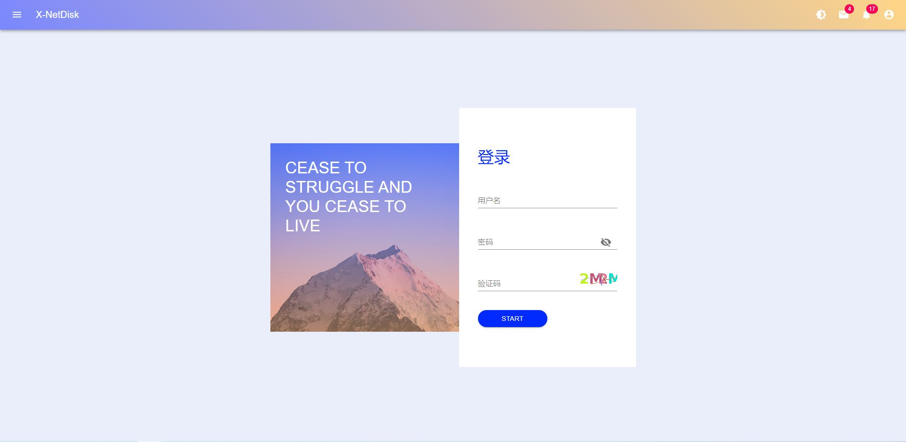
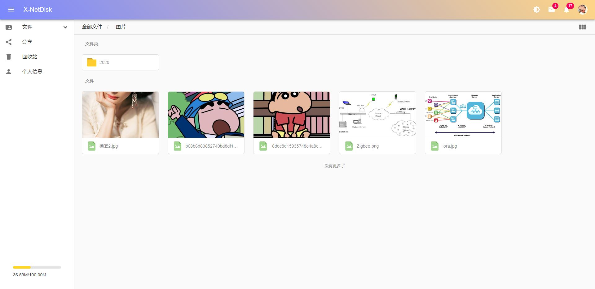

# x-netdisk React Web 客户端

基于 React 18 + TypeScript + Vite 的网盘前端。为保持原页面布局，UI 层继续使用 Material UI 4，路由使用 HashRouter。

环境要求：Node.js 20.19+、pnpm 10+。

## 功能

- 登录 / 注册：图形验证码登录，邮箱验证码注册。
- 文件管理：上传、下载、新建文件夹、移动、删除，图片 / 视频 / 音乐 / 文档分类浏览。
- 文件预览：图片、视频、音乐、PDF 文档。
- 分享：创建公开 / 私密分享，管理分享记录并查看访问、下载、保存次数；访客可通过分享链接浏览目录、预览、下载、保存到自己的“我的资源”。
- 回收站：列表、搜索、恢复文件与彻底删除，到期文件由后台自动清理。
- 个人信息：头像上传、资料编辑、修改密码、邮箱与手机号改绑、存储空间展示。
- 其它：深浅色主题切换、侧边栏容量占用显示。

## 开发

```bash
pnpm install
pnpm dev
```

打开 <http://localhost:3000>。开发环境接口统一走 `/netdisk` 前缀，由 Vite 代理到后端，代理目标在 `vite.config.ts` 中配置（默认示例为 `http://localhost:8080`）。

## 检查与构建

```bash
pnpm typecheck
pnpm build
pnpm preview
```

生产构建输出到 `dist`。生产环境接口地址默认是同源路径 `/netdisk`。

## Docker 部署

```bash
docker compose up -d --build
```

访问 <http://localhost:8088>。镜像采用两阶段构建：Node 构建静态文件，Nginx 仅托管前端页面，不代理后端。部署时需由外部网关将同源 `/netdisk` 路径路由到后端。

| 变量 | 默认值 | 说明 |
| --- | --- | --- |
| `WEB_PORT` | `8088` | 宿主机映射端口 |
| `VITE_API_BASE_URL` | `/netdisk` | 前端接口路径（构建参数，通常无需修改） |

也可直接使用 Docker 构建：

```bash
docker build -t x-netdisk-react .
docker run -d -p 8088:80 x-netdisk-react
```

## 目录结构

```
src/
├── api/          # 接口封装（user、file、share、recycle）
├── components/   # 页面与组件（file、share、recycle、user、login 等）
├── utils/        # request / shareRequest、RSA 加密、鉴权、文件工具
├── store/        # Redux store
├── reducers/     # Redux reducer
├── actions/      # Redux action
└── conf/         # 运行时配置（接口地址）
```

## TypeScript 迁移说明

数据层、Redux、配置和应用入口已纳入 TypeScript 检查。部分旧 UI 与上传/预览组件仍依赖 PropTypes 和不兼容 React 18 的第三方类型，暂以文件级 `@ts-nocheck` 保持行为不变，后续可按模块逐步补齐类型并移除标记。

## 截图





## 特别感谢

- [Cloudreve](https://github.com/Cloudreve/Cloudreve)，主要样式参考该开源项目。
